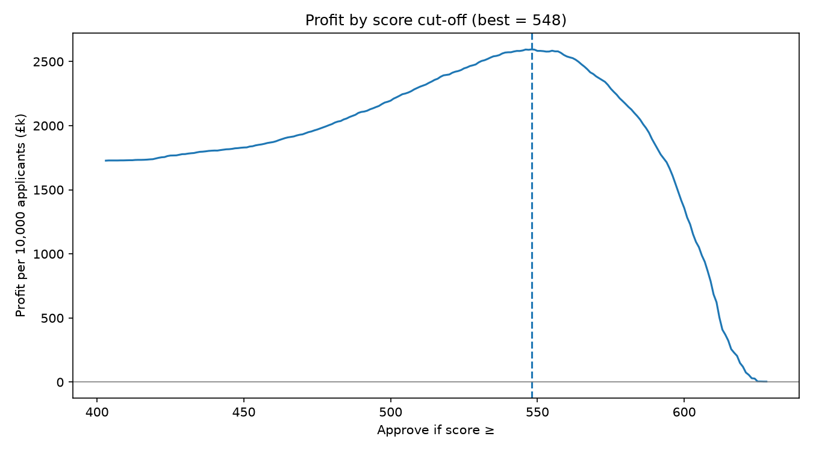
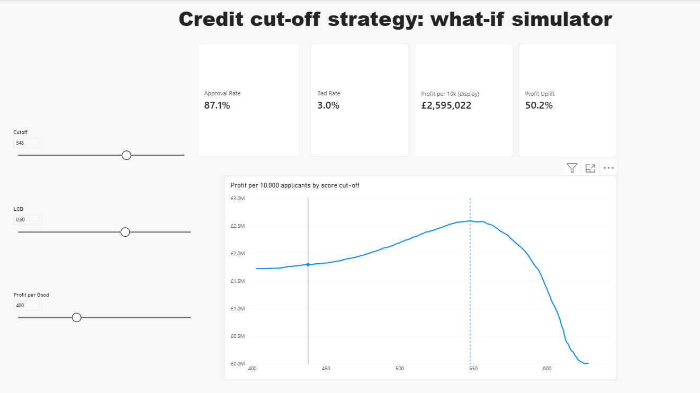
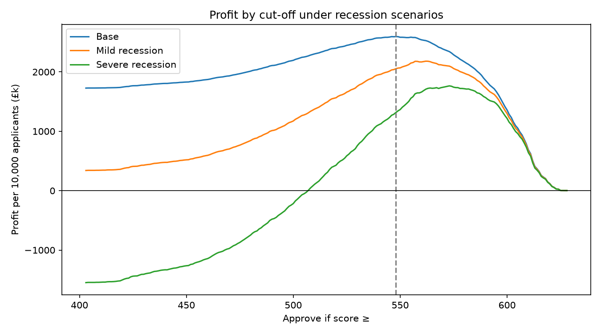

# Credit Scorecard & Cut-off Strategy: a Consumer Duty-ready lending decision

**The decision:** approve applicants scoring **548 or above**.
Compared with approving everyone, this declines 12.9% of applicants, cuts the bad rate from **6.7% to 3.0%** and raises profit by **about 50%** (from £1.73m to £2.60m per 10,000 applicants, using the illustrative £ assumptions below).

The project goes beyond building a model. It answers the questions a UK credit committee would ask before approving one:

| Question | Answer |
|---|---|
| Does the model rank risk well? | Gini **0.716** on a held-out test set (train 0.715, so there's no overfitting); KS **0.563** |
| Where should we set the cut-off? | **548**, chosen to maximise profit rather than accuracy |
| Can a manager test other assumptions? | Yes: a Power BI what-if simulator with cut-off, LGD and margin sliders |
| Can we explain each decline to the customer? | Yes: the top 2 plain-English reasons for every declined applicant |
| Is it fair across age groups? | Tested with and without age. Removing age costs **0.2%** of profit and lifts the youngest group above the 0.8 impact ratio |
| What happens in a recession? | 548 stays profitable even if defaults double; a trigger-based policy raises it to 562 / 573 |

---

## 1. Scorecard: WoE / IV logistic regression

- **Data:** *Give Me Some Credit* (Kaggle), 150,000 borrowers, with a 6.7% two-year serious delinquency rate.
- **Cleaning:** I removed 1 impossible age (0). I treated the 96/98 "special codes" in 269 late-payment rows as unknown, rather than as 96 real late payments, and set 241 utilisation values above 1,000% to missing. I kept 3,080 genuine over-limit cases, because they are a real risk signal. Missing income (19.8%) was kept as its own **"Missing" group** rather than filled with an average, because not declaring income is information in itself.
- **Split:** 70/30 train/test, stratified so both halves have the same 6.68% default rate. All bins and weights were learned on train only.
- **Binning:** Weight of Evidence (WoE) and Information Value (IV), the standard approach in UK retail credit because every bin can be explained.

| Feature | IV | Strength |
|---|---|---|
| Revolving utilisation | 1.146 | Very strong |
| 90+ days late | 0.887 | Very strong |
| 30–59 days late | 0.739 | Very strong |
| 60–89 days late | 0.600 | Very strong |
| Age | 0.226 | Medium |
| Open credit lines, income, debt ratio, property loans, dependants | 0.036–0.079 | Weak |

The very high IVs were checked for leakage. They are pre-application arrears history, which is well known to be the strongest predictor of future default. No two features correlate above 0.35, and all model coefficients have the expected sign.

**Utilisation tells the story:** applicants using under 10% of their limits defaulted at **1.9%**, compared with **39.2%** for those over their limit.

**Points scaling:** 600 points means good:bad odds of 50:1, and every 20 points doubles the odds (PDO = 20). Scores range from 403 to 628.

| Score decile | Score range | Bad rate |
|---|---|---|
| 1 (lowest) | 403–538 | **36.4%** |
| 5 | 583–591 | 2.7% |
| 10 (highest) | 614–628 | **0.5%** |

The lowest-scoring 10% of applicants contain **about 55% of all defaulters**.

## 2. Profit-based cut-off

Illustrative unsecured personal loan assumptions: a **£5,000** loan, **£400** profit per good customer, and **60% LGD** (so £3,000 lost per default). These give a break-even bad rate of **11.8%**.



| Strategy | Approval | Bad rate | Profit per 10k applicants |
|---|---|---|---|
| Approve everyone | 100% | 6.7% | £1,727,289 |
| **Cut-off 548** | **87.1%** | **3.0%** | **£2,595,022** |

The optimum sits where the applicants at the margin are close to break-even: the 539–558 score band has an 11.2% bad rate, against the 11.8% break-even. **Sensitivity:** across LGD values of 40%, 60% and 80%, the best cut-off only moves between 539 and 557, so the recommendation is robust to the assumptions.

## 3. Power BI what-if simulator



Three sliders (score cut-off, LGD, profit per good customer) recalculate the approval rate, bad rate, profit and uplift versus approve-all live in DAX, from the 45,000 scored test customers. The profit curve redraws as the assumptions change, and a marker shows the chosen cut-off. **It reconciles to the Python output to the pound** (£2,595,022 at 548).

## 4. Decline reason codes (Consumer Duty: consumer understanding)

For each declined applicant, the two features where they lost the most points (compared with that feature's best bin) become their plain-English reasons, along with how many points short they were.

| Main decline reason | Share of declines | Avg points short | Bad rate |
|---|---|---|---|
| High use of available credit limits | 73.3% | 29.6 | 28.1% |
| Serious arrears (90+ days late) | 18.7% | 56.4 | 46.8% |
| Recent missed payments (30–59 days) | 6.2% | 19.6 | 26.5% |
| Missed payments (60–89 days) | 1.9% | 14.3 | 25.9% |

Age was never the main decline reason. Utilisation-driven declines are closer to the line, which makes them candidates for a credit-builder product or manual review.

## 5. Fairness by age (Equality Act 2010 / Consumer Duty outcomes)

| Age group | Actual bad rate | Approval with age | Approval without age |
|---|---|---|---|
| 18–29 | 12.4% | 74.8% (impact ratio **0.78**) | 77.7% (impact ratio **0.82**) |
| 30–44 | 9.7% | 79.5% | 80.8% |
| 45–59 | 7.0% | 86.7% | 86.5% |
| 60+ | 2.9% | 95.7% | 94.4% |

- Removing age: Gini moves from 0.716 to **0.709**, and profit falls by **£6,044 per 10k applicants (0.2%)**, at the same 87.1% overall approval rate.
- **Recommendation:** remove age. The cost is small, the youngest group moves above the four-fifths (0.8) threshold, and the bank no longer has to justify a protected characteristic in its model.
- **Caveat:** some of the age gap remains, because features such as utilisation and arrears are partly correlated with age (proxies). The remaining gap reflects genuine differences in repayment behaviour, but outcomes by age should be monitored after launch.

## 6. Recession stress test



| Scenario | Defaults | LGD | Profit at 548 | Approve-all profit | Best cut-off | Cost of not adjusting |
|---|---|---|---|---|---|---|
| Base | ×1.0 | 60% | £2,595,022 | £1,727,289 | 548 | £0 |
| Mild recession | ×1.5 | 65% | £2,053,678 | £340,267 | 562 | £127,006 |
| Severe recession | ×2.0 | 75% | £1,316,667 | **−£1,548,089** | 573 | £448,267 |

**Recommendation:** keep 548 in normal conditions and agree triggers in advance. If early arrears rise about 50%, move to 562; if they double, move to 573.

## 7. SQL

`08_sql_analysis.ipynb` reproduces the key results in SQL using a CTE, a CROSS JOIN of cut-offs against applicants, CASE WHEN, and the window functions NTILE and SUM() OVER(). The profit at 548 matches Python and Power BI exactly.

---

## Repository structure

```
notebooks
  01_explore_data.ipynb      first look: shape, missing values, default rate
  02_clean_data.ipynb        impossible values, special codes, stratified split
  03_scorecard.ipynb         WoE / IV, logistic regression, points, Gini / KS, deciles
  04_cutoff_strategy.ipynb   profit curve, best cut-off, LGD sensitivity
  05_reason_codes.ipynb      top 2 decline reasons per applicant
  06_fairness_age.ipynb      approval by age, with vs without age, £ cost
  07_stress_test.ipynb       3 recession scenarios
  08_sql_analysis.ipynb      key results reproduced in SQL
credit_cutoff_dashboard.pbix Power BI what-if simulator
outputs/                     charts, scorecard points table, results CSVs
data/clean/                  train / test / scored test files
```

The raw file `cs-training.csv` is not included. Download it from Kaggle (*Give Me Some Credit*) into `data/raw/`, then run the notebooks in order.

**Tools:** Python (pandas, NumPy, scikit-learn, matplotlib), SQL (SQLite), Power BI (DAX what-if parameters).

## Limitations

- The data is a public US dataset from 2011. The £ figures are illustrative assumptions, not real lender economics.
- The outcome is defined as "90+ days late within 2 years". A real lender might use a different default definition.
- Only approved borrowers have outcomes (**reject inference** problem): applicants who were declined in the past have no repayment history, which can bias any scorecard.
- The stress test scales observed defaults evenly. A real recession would hit some segments harder than others.
- The fairness check covers age only, because no other protected characteristics are in the data.

## What I'd do with real lender data

- Use the lender's actual margin, funding cost and LGD by product, and set the cut-off per product.
- Add credit bureau data and affordability checks (income verification, expenditure).
- Apply reject inference and monitor the population stability index (PSI) after launch.
- Run the fairness check across every protected characteristic available, plus vulnerable-customer flags.
- Test the refer band (applicants just below the cut-off) through manual underwriting, and track how those customers perform.
